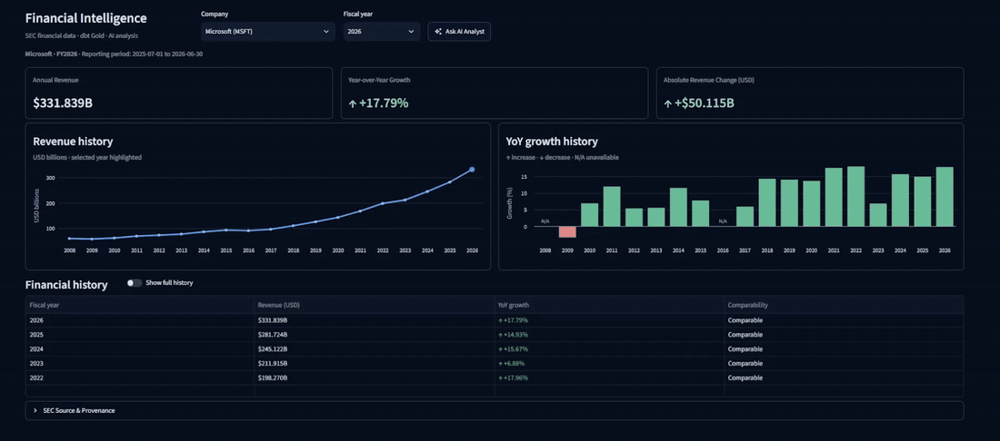
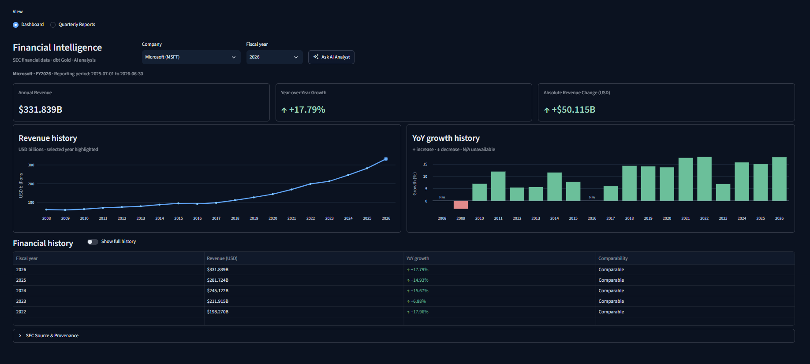
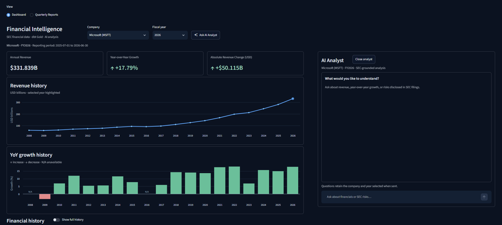
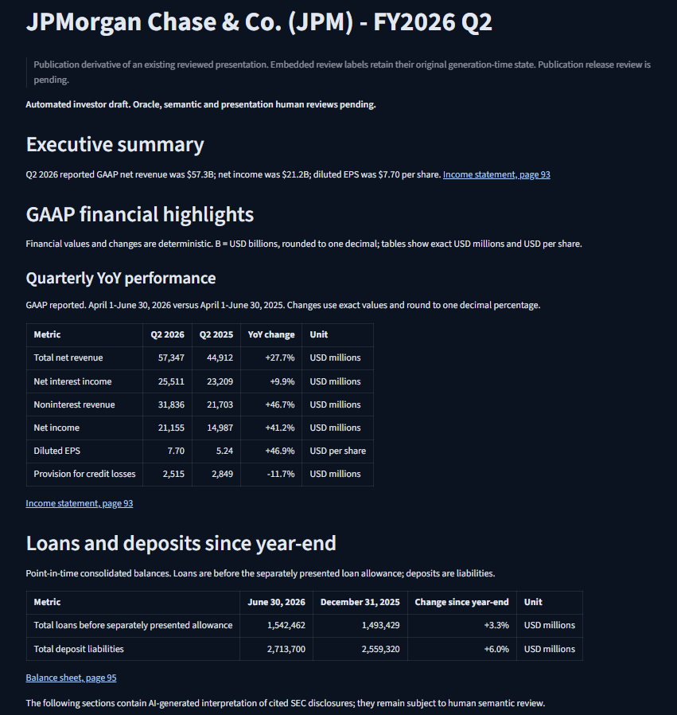
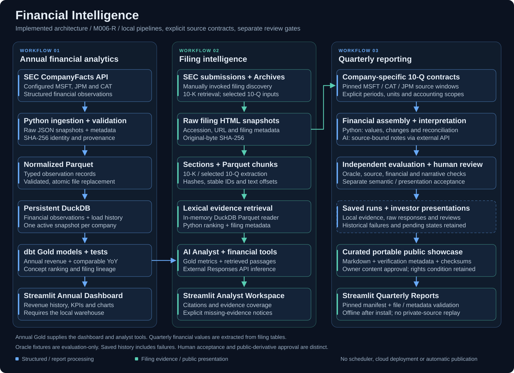

# Financial Intelligence

**SEC data engineering, traceable financial analytics and evaluated AI interpretation.**

Financial Intelligence turns SEC CompanyFacts and filing HTML into a local analytics workspace and source-grounded quarterly reports. Python, Parquet, DuckDB and dbt handle data processing; deterministic calculations, independent ground truth and human review constrain AI-assisted interpretation.

## Demo & Screenshots

<a href="assets/demo.gif"></a>

*Working dashboard and AI Analyst workflow. [Open the unchanged demo at full size](assets/demo.gif).*

<table width="100%">
<tr>
<th width="50%">Annual Dashboard</th>
<th width="50%">AI Analyst</th>
</tr>
<tr>
<td width="50%" valign="top">
<a href="assets/dashboard.png"></a>
<p>CompanyFacts through dbt Gold: annual KPIs, comparable growth and filing lineage.</p>
</td>
<td width="50%" valign="top">
<a href="assets/ai_analyst.png"></a>
<p>Company/year context with financial tools, retrieved evidence and cited analysis.</p>
</td>
</tr>
</table>

<p align="center"><strong>Quarterly Reports</strong></p>
<p align="center">
<a href="assets/quarterly_reports.png"></a>
</p>
<p align="center">JPM quarterly report: exact financial tables, accounting scopes and SEC citations.</p>

Click a screenshot for full size. **The three saved quarterly reports run without API keys, SEC downloads or local warehouse data.**

[Quick start](#getting-started) | [Architecture](#architecture) | [Engineering challenges](#engineering-challenges--solutions) | [Verified results](#verified-results) | [Testing](#testing--reliability)

## Overview

Financial disclosures combine repeated observations, changing accounting bases, company-specific table layouts and narrative explanations. A useful report needs more than a plausible summary: figures must retain their period, unit, reporting basis and source.

The project implements three connected workflows:

- **Annual analytics:** ingest CompanyFacts, preserve snapshots, normalize observations and build comparable revenue/YoY models for MSFT, CAT and JPM.
- **Filing intelligence:** extract filing sections, retrieve evidence and combine it with structured metrics in a contextual AI Analyst.
- **Quarterly reporting:** apply explicit contracts to selected 10-Q filings, calculate financials deterministically and evaluate source-bound interpretation before investor presentation.

This is a local, manually invoked portfolio system. The portable showcase demonstrates saved results; it does not run ingestion or generate new reports when opened.

## Architecture

<a href="assets/architecture_m006r.svg"></a>

[Full-size diagram and editable SVG](assets/architecture_m006r.svg). The original [PNG](assets/architecture.png) and [SVG](assets/architecture.svg) are preserved as earlier architecture references.

| Workflow | Storage and processing | Consumer |
|---|---|---|
| Annual financial data | Hashed JSON snapshots -> normalized Parquet -> persistent DuckDB -> dbt Gold | Annual Dashboard and financial tools |
| Filing evidence | Hashed HTML snapshots -> section/chunk Parquet -> lexical retrieval using in-memory DuckDB and Python | AI Analyst |
| Quarterly reporting | Pinned 10-Q tables/spans -> deterministic assembly and AI notes -> independent checks and separate human review | Saved investor presentations |
| Public presentation | Explicit curation -> Markdown, verification metadata and checksums -> pinned-manifest validation | Streamlit Quarterly Reports |

Annual Gold does not supply quarterly report figures. Quarterly calculations read filing tables through company-specific contracts. The public viewer has no private-source fallback and does not rerun original evaluations.

External inference is limited to the AI workflows through the OpenAI Responses API. Ingestion, storage, SQL transformations, retrieval and snapshot viewing execute locally. The diagram represents implemented flows, not a deployment or scheduling platform.

## Technology Stack

| Layer | Technology | Responsibility |
|---|---|---|
| Ingestion | Python, Requests | SEC requests, payload validation and raw snapshots |
| Filing extraction | BeautifulSoup, lxml | HTML parsing, section resolution and evidence windows |
| Intermediate data | PyArrow, Parquet | Typed observations, sections and deterministic chunks |
| Analytical storage | DuckDB | Persistent financial warehouse; separate in-memory Parquet retrieval |
| Transformation | dbt-duckdb, SQL | Annual revenue selection, growth, comparability and data tests |
| Financial reporting | Python Decimal | Source-bound values, changes and accounting reconciliations |
| AI integration | OpenAI Responses API, structured outputs | Tool-driven analyst responses and bounded report interpretation |
| Presentation | Streamlit, pandas, Altair | Dashboard, charts, analyst workspace and portable report viewer |
| Verification | pytest, dbt tests, GitHub Actions | Regression, contract, integrity, presentation and fixture-based CI checks |

## Data Engineering Pipeline

### 1. Ingest and preserve source snapshots

[run_pipeline.py](run_pipeline.py) processes the three configured companies through [CompanyFacts ingestion](src/ingestion/companyfacts.py). It validates identity and payload structure before saving raw bytes and metadata. The payload's SHA-256 identifies the snapshot used downstream.

[run_filings.py](run_filings.py) runs independently. It discovers the latest available 10-K when explicitly invoked, or accepts a form/accession selection. Filing snapshots retain accession, URL, dates and original-byte hash. Selected quarterly workflows use pinned filings rather than unrestricted discovery.

Raw source retention separates the evidence observed during a run from later transformed outputs. These hashes support local consistency checks; they are not independent SEC authentication.

### 2. Normalize observations and control active data

[src/transformation/load_companyfacts.py](src/transformation/load_companyfacts.py) flattens CompanyFacts into typed Parquet observations, preserving concept, unit, period and filing identifiers.

Processed files are validated before atomic replacement. The DuckDB loader checks snapshot identity, company, row count and observation indices before completing a transaction.

The warehouse deliberately holds one active snapshot per company:

- Repeating the same payload does not duplicate observations.
- A newer payload replaces that company's active observations transactionally.
- Older replacements are rejected, and failed loads roll back.
- Other companies' active data remains unchanged.

Raw snapshots and load metadata preserve history around that active-data policy. The warehouse is not a collection of every downloaded payload merged together.

### 3. Build governed annual metrics with dbt

[annual_revenue.sql](dbt/models/gold/annual_revenue.sql) filters annual USD observations and ranks revenue concepts separately by company. It selects one observation per company/year-end, using filing recency and deterministic tie-breaks, and exposes the source concept and filing metadata.

[annual_revenue_growth.sql](dbt/models/gold/annual_revenue_growth.sql) uses consecutive fiscal years and a positive prior value for growth. It suppresses the known Microsoft FY2016 basis mismatch rather than comparing recast revenue with the older FY2015 basis.

The resulting tables are:

- `main_gold.annual_revenue`
- `main_gold.annual_revenue_growth`

Both live in `data/warehouse/financial_intelligence.duckdb`. The Streamlit annual dashboard reads these models; it does not reconstruct financial calculations in the presentation layer.

### 4. Preserve filing evidence for retrieval

Filing processing extracts 10-K Items 1A and 7, and the implemented selected 10-Q sections. It handles supported layouts, including JPM's referenced MD&A structure, rather than promising general coverage of all SEC HTML.

[src/transformation/chunk_filings.py](src/transformation/chunk_filings.py) creates sentence-aware chunks targeting 300 words with a 350-word maximum. Stable IDs, section hashes and character offsets support reconstruction and source tracing.

[src/retrieval/search_filings.py](src/retrieval/search_filings.py) reads chunk Parquet with an in-memory DuckDB connection and ranks passages in Python. It uses whole-word matches, phrase bonuses and deterministic ranking, with ticker/accession filtering. Filing retrieval bypasses dbt and the persistent financial warehouse.

### 5. Apply explicit quarterly financial contracts

[Report profiles](src/analytics/report_profiles.py) define named filings, table selectors and interpretation topics. The [JPM extractor](src/analytics/jpm_extraction.py) separately binds its mixed stock/flow financial contract to pinned source evidence.

The deterministic assembly workflow extracts exact financial values, calculates changes with Decimal and preserves reporting basis and citations. CAT adds external/intersegment/consolidated reconciliation; JPM adds reported/FTE/managed, loan-allowance and credit-loss identities.

Quarterly reporting is not an annual dashboard query with a different date filter. Adding a company or quarter requires source bindings, independent expected results and review of its accounting context.

## AI Engineering

### Separate calculations from interpretation

The deterministic assembly path supplies financial values and source evidence in code. The model returns concise interpretation notes with eligible span IDs; it does not supply the authoritative calculations.

[src/ai/report_assembly.py](src/ai/report_assembly.py) constrains note structure and topic-bound sources, resolves citations and assembles the report. The independent ground-truth fixtures are evaluation-only and are not sent to the model.

The legacy Microsoft baseline can still generate financial output through the older model path. The deterministic mode is an explicit workflow, not a silent change to that historical default; CAT and JPM require it.

### Ground the analyst in separate evidence tools

The contextual analyst requests annual metrics and filing passages through separate tools. Gold values support financial statements; retrieved passages support qualitative explanations. Missing required evidence produces an explicit missing-evidence response instead of substituting an unrelated source.

Risk-reference checks bind ticker, chunk identity and source URL to retrieved evidence. Retrieval relevance or a valid citation does not prove every interpretation, causal claim or accounting conclusion.

### Evaluate and review before claiming acceptance

Evaluation compares financials with independent fixtures and checks source membership, periods, scope, units, topic coverage and bounded narrative rules. Monetary checks examine dimensions and scale in prose as well as structured tables.

Human semantic review and presentation acceptance remain distinct. An automatic pass can coexist with pending review and `overall_pass: false`. Historical failures and generation-time pending states remain immutable records; later documented acceptance is represented separately.

Private runs preserve source evidence, prompts, raw responses, evaluation results and review lineage. The curated public showcase retains concise reporting and saved-status metadata without distributing those complete archives.

## Engineering Challenges & Solutions


### 1. Comparable metrics from changing SEC observations

**Challenge:** CompanyFacts contains competing revenue concepts and repeated periods. Microsoft's recast FY2016 revenue is not comparable with the older FY2015 basis.

**Solution:** Rank concepts by company, select one annual observation per year-end and retain provenance. Guard growth comparisons and suppress FY2016 growth. Load one active snapshot per company transactionally, rejecting older replacements.

**Result:** Gold exposes comparability; dbt assertions verify uniqueness/growth, and lifecycle tests verify idempotency, rollback and company isolation. The accounting exclusion is targeted, not a general restatement detector.

Evidence: [revenue selection](dbt/models/gold/annual_revenue.sql), [growth model](dbt/models/gold/annual_revenue_growth.sql), [dbt assertions](dbt/tests), [snapshot tests](tests/test_snapshot_lifecycle.py).

### 2. A banking quarter needs different financial contracts

**Challenge:** JPM mixes quarterly flows with year-end balance comparisons. Its $31,366 million principal allowance differs from the $31,531 million firmwide stock; reported and managed/FTE revenue also differ.

**Solution:** Bind periods, units and scopes to pinned source tables; assemble deterministically and evaluate 14 reconciliations against an independently transcribed oracle.

**Result:** Saved checks pass 16/16 values, six YoY changes, two year-end changes and 14 reconciliations. Tests reject scope substitutions and mutually consistent but incorrect production figures.

Evidence: [M006 accounting boundaries](evals/M006.md), [JPM extractor](src/analytics/jpm_extraction.py), [independent-oracle and reporting tests](tests/test_jpm_reporting.py).

### 3. Correct citations did not prevent a misleading AI amount

**Challenge:** CAT prose said "$41" and "$33" instead of millions despite passing structured-value/citation checks. A later valid response exposed an EPS-context parsing gap across longer date phrases.

**Solution:** Check prose amounts against cited scales/dimensions, then add bounded EPS-context grammar. Preserve original responses and failures without silently repairing text.

**Result:** The defective response remains rejected and the valid second response passes. Recorded verification: 78 monetary/EPS tests passed; 12/12 monetary mentions supported in the successful CAT evaluation.

Evidence: [recorded unit failure](evals/M005_QUALITY.md), [EPS root cause and correction](evals/M005_EPS_CONTEXT.md), [monetary tests](tests/test_narrative_money.py), [EPS tests](tests/test_eps_context.py).

### 4. An offline showcase without private runtime artifacts

**Challenge:** Original presentations depend on ignored local filings and review artifacts. The showcase must run without them while accurately describing what it verifies.

**Solution:** Curate Markdown, SEC links, verification records and checksums. Use a pinned manifest, strict metadata checks and no private fallback; separate original acceptance from derivative approval.

**Result:** An isolated Streamlit test renders all three reports without private data, credentials or external network access. Missing files, altered hashes and overstated approval metadata fail closed.

Evidence: [public loader](src/ui/public_quarterly_reports.py), [portable and failure tests](tests/test_public_quarterly_reports.py), [publication scope](showcase/quarterly/NOTICE.md).

## Verified Results


These are specific filing cases, not arbitrary-company support. Counts below are **saved original automatic evaluations**, not source evaluations rerun by the public viewer.

| Report | Period | Values | YoY | Source-supported pairs |
|---|---|---:|---:|---:|
| [MSFT FY2026 Q1](showcase/quarterly/msft_fy2026_q1/report.md) | July-September 2025 vs July-September 2024 | 14/14 | 7/7 | 7/7 |
| [CAT FY2026 Q1](showcase/quarterly/cat_2026_q1/report.md) | January-March 2026 vs January-March 2025 | 16/16 | 8/8 | 8/8 |
| [JPM FY2026 Q2](showcase/quarterly/jpm_2026_q2/report.md) | April-June 2026 vs April-June 2025; stocks at June 30 vs December 31, 2025 | 16/16 | 6/6 | 8/8 |

MSFT distinguishes GAAP/adjusted earnings and Azure growth versus Cloud margin. CAT adds retrospective segments, affiliate/intersegment qualifications and 48 reconciliation values. JPM separates stock/flow and accounting scopes. The earlier MSFT FY2027 Q1 experiment is outside this showcase.

### Review status is separate from automatic success

| Case | Semantic / presentation evidence | Public derivative status |
|---|---|---|
| MSFT | Passed saved semantic reviews; presentation acceptance documented in M004; archived presentation record remains pending | Separate owner content approval, subject to rights restrictions |
| CAT | Separate passed reviews and hash-bound acceptance for the original presentation | Separate owner content approval; original approval is not transferred |
| JPM | Acceptance documented in M006; archived reviews remain pending; no final hash-bound original presentation approval | Separate owner content approval, subject to rights restrictions |

MSFT also has no final hash-bound original presentation approval. Separate [owner content approval](showcase/quarterly/publication_approval.json) now binds the six public Markdown files to their exact hashes, subject to remaining rights restrictions. It is not legal clearance or issuer permission. No concrete restriction was identified in the local review; SEC access alone does not establish rights. See [NOTICE.md](showcase/quarterly/NOTICE.md).

## Getting Started

### Fastest path: portable Quarterly Reports

Python 3.12 was used locally; [CI](.github/workflows/ci.yml) is configured for Python 3.13. Run these PowerShell commands from the checkout:

```powershell
git clone https://github.com/Samtoussi/financial-intelligence.git
cd financial-intelligence
python -m venv .venv
.\.venv\Scripts\Activate.ps1
python -m pip install -r requirements.txt
python -m streamlit run app.py
```

On macOS/Linux, use `source .venv/bin/activate`. Dependency installation needs internet access. Once installed, **Quarterly Reports** is the default view:

1. Select MSFT, CAT or JPM.
2. Read the report and saved review-status summary.
3. Expand supporting detail for exact financials and SEC links.

No `.env`, API key, DuckDB dataset, SEC download or private `evals/reports/` directory is required. External links require internet access. Opening the app does not populate data or generate a report.

### Optional: populate the annual dashboard

```powershell
$env:SEC_USER_AGENT = "FinancialIntelligence your-email@example.com"
python run_pipeline.py
```

Use your real contact address. This manually runs CompanyFacts ingestion for MSFT, JPM and CAT, normalization, warehouse loading and `dbt build`. After it succeeds, switch Streamlit to **Dashboard**.

The runner reads `SEC_USER_AGENT` from the process environment, not `.env`. Local datasets are ignored by version control and are absent from a fresh checkout. The dashboard cannot show annual financials until its warehouse is populated.

### Optional: filing retrieval and AI Analyst

```powershell
# Latest available 10-K per configured ticker; separate from CompanyFacts.
python -m run_filings MSFT
python -m run_filings JPM
python -m run_filings CAT

# Search the local corpus after chunks have been created.
python -m src.retrieval.search_filings "interest rate risk" --ticker JPM --limit 5

# Required only for AI questions, which call the external API.
$env:OPENAI_API_KEY = "your-openai-api-key"
```

The filing CLI also accepts `--form 10-Q --accession <accession>` for explicit selection. It builds sections/chunks, not investor reports. AI questions may need both financial and filing evidence; viewing annual charts alone needs no API key.

The analyst and quarterly runner support a root `.env` based on [.env.example](.env.example), with existing environment variables taking precedence. Ingestion runners still need the process environment set explicitly. Keep credentials local.

### Developer quarterly workflows

```powershell
python evals/run_report.py --help
python evals/render_investor_report.py --help
```

Generation needs pinned source artifacts, a configured profile and API access. MSFT offers `--generation-mode m003-v2` for deterministic assembly; CAT requires that mode. JPM requires its cached pinned-source deterministic path and rejects `--download`.

The legacy default is the separate MSFT FY2027 Q1 experiment. Use the milestone guides below for exact source preparation instead of treating the CLI as an arbitrary-ticker summarizer.

`--evaluate-run` makes no model/SEC call, but **writes evaluation and run metadata**. The investor renderer writes a new presentation from eligible inputs. Neither is a read-only public-integrity command.

The quarterly runner returns 0 for overall pass, 2 for automatic pass with review pending, and 1 for failure. Human acceptance does not trigger automatic publication.

## Testing & Reliability

### Run the offline suites

```powershell
# Full suite; model behavior uses controlled responses.
python -m pytest tests -q

# Public integrity and private saved-report review distinctions.
python -m pytest tests/test_public_quarterly_reports.py tests/test_quarterly_reports.py -q

# Optional: against a populated local financial warehouse.
dbt build --project-dir dbt --profiles-dir dbt
```

**Recorded local verification:** 1,111 Python tests passed with 14 parser warnings; the focused public/private report suites passed 163 tests. These are historical local results, not a new dependency-install test or a statistical reliability estimate for live generation.

dbt defines 16 data tests covering required fields, uniqueness, valid annual observations, growth calculations and comparability.

### What the tests establish

| Area | Representative verification |
|---|---|
| Snapshot lifecycle | Idempotency, older-snapshot rejection, rollback, cross-company isolation |
| Financial models | Concept selection, annual deduplication, source metadata and comparison guards |
| Filing evidence | Extraction boundaries, normalized-text reconstruction, stable chunks and source references |
| Quarterly accounting | Independent expected values; wrong periods, units, scopes and reconciliation substitutions rejected |
| AI interpretation | Eligible topic citations, monetary dimensions, defective saved-response rejection and bounded safeguards |
| Presentation | Exact/display values, source links, pending review distinctions and malformed artifact rejection |
| Portability | All three public reports rendered without private artifacts, API credentials or external network |

The clean-checkout test copies repository files plus the proposed bundle into an isolated directory without `data/` or private reports. It blocks private backend imports and external networking, then renders each report with Streamlit AppTest. It verifies route independence, not a new remote clone or dependency installation.

[GitHub Actions](.github/workflows/ci.yml) installs dependencies, builds a [synthetic DuckDB fixture](scripts/create_ci_db.py), runs dbt and executes pytest. CI does not perform live SEC ingestion or paid inference. Cached real-source checks may skip when private snapshots are unavailable; synthetic fixtures do not substitute for original SEC authentication.

### Public checks versus original evaluations

| Available from the checkout | Requires original local evidence |
|---|---|
| Public manifest and file checksum verification | Original filing extraction and source hash replay |
| Strict public identity/status metadata checks | Original financial/narrative evaluation reconstruction |
| Fixture-based regression tests | Historical live request/response artifacts |
| Offline saved-report viewing | Historical human-review records and their full lineage |

Public verification reports saved outcomes; it does not independently rerun private evaluations. A coordinated edit to all local records is outside checksum guarantees. Original-record hashes are provenance references, not signatures or independent assurance.

The separate [analyst evaluation runner](evals/run.py) needs local data and paid API access and writes evaluation artifacts. It is outside the offline test workflow.

## Design Decisions & Trade-offs

| Decision | Reason | Trade-off |
|---|---|---|
| Local Parquet + DuckDB | Inspectable intermediate data and SQL analytics without running a database service | A local workflow, not a multi-user serving platform |
| dbt for annual metrics | Versioned selection/comparability logic and data tests | Company-specific rules still need accounting review |
| Separate filing storage | Narrative evidence has different contracts from annual observations | Two explicit data paths to maintain |
| Deterministic financial assembly | Keep arithmetic, periods and reconciliation independent of prose generation | Each filing layout needs extraction bindings |
| Lexical retrieval | Transparent ranking without embeddings or vector infrastructure | Limited semantic recall and no fiscal-year filter |
| Independent oracle + human review | Catch self-consistent errors and assess meaning beyond numeric checks | Manual acceptance remains necessary |
| Curated public derivatives | Demonstrate results without requiring or distributing private runtime archives | Public integrity is narrower than full source replay |

The system avoids additional orchestration, cloud services and storage layers because they are not necessary for the implemented scope. No scheduler, hosted deployment or autonomous-agent service is implied.

## Known Limitations & Roadmap

### Current boundaries

- Annual analytics cover revenue and YoY for three configured companies. Quarterly support is tied to named filings and observed layouts, not any ticker or period.
- Comparison guards include targeted accounting knowledge. They are not a universal restatement or reporting-basis detector.
- Retrieval has no fiscal-year filter. A dashboard year selection does not guarantee matching passage periods.
- Citation membership and bounded narrative checks do not prove complete entailment, causation or investment suitability.
- SEC access and model output can fail. Invalid or incomplete evidence does not become a passing result; the UI reports missing data or analysis failures.
- Analyst inference sends question/context and supporting evidence to an external API. Displayed history is not reused as conversational context; progressive display begins after analysis completes.
- Publication-derivative content approval is recorded separately from original reviews and independent evaluation. It is conditional on resolving any concrete applicable rights restriction. General legal uncertainty remains; no specific restriction or redistribution permission was established by the local review.

### Possible next steps, not implemented

1. Add a reporting-period filter to filing retrieval before broadening its historical-analysis use.
2. Extend one explicitly selected filing at a time, with new extraction bindings, independent oracle evidence and semantic review.
3. Improve fresh-install/reproduction documentation as additional environments are actually verified.

These are bounded directions, not delivered features or an infrastructure commitment. This remains an engineering portfolio project, not an investment advisory service.

## Further Documentation

| Reference | Detail |
|---|---|
| [Source code](src), [dbt models](dbt/models/gold), [tests](tests) | Implemented ingestion, transformation, retrieval, AI and quality checks |
| [Public showcase](showcase/quarterly), [manifest](showcase/quarterly/manifest.json), [notice](showcase/quarterly/NOTICE.md) | Reports, supporting detail, saved results and publication boundaries |
| [M002 baseline](evals/M002.md), [M003 profiles](evals/M003.md) | Microsoft experiments and deterministic assembly |
| [M004 presentation](evals/M004.md) | Offline investor renderer and presentation gates |
| [M005 Caterpillar](evals/M005.md), [monetary-unit failure](evals/M005_QUALITY.md), [EPS correction](evals/M005_EPS_CONTEXT.md) | Accounting extension and recorded debugging evidence |
| [CAT final verification](evals/M005_FINAL_VERIFICATION.md) | Original-source verification and separate original approval |
| [M006 JPMorgan Chase](evals/M006.md) | Mixed-period/scoped contracts, reconciliations and review history |
| [Current architecture source](assets/architecture_m006r.svg) | Versioned, editable diagram for this implemented system |

Local `data/` and `evals/reports/` remain ignored runtime/audit locations. They are not prerequisites for the portable showcase.
