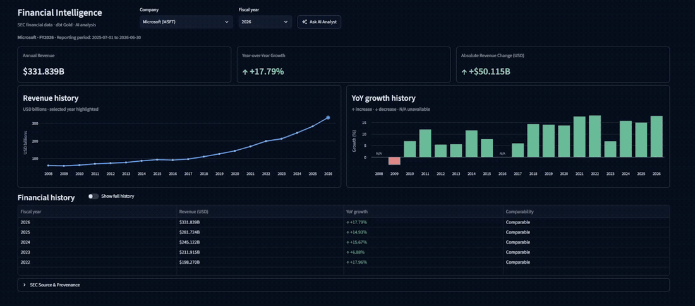
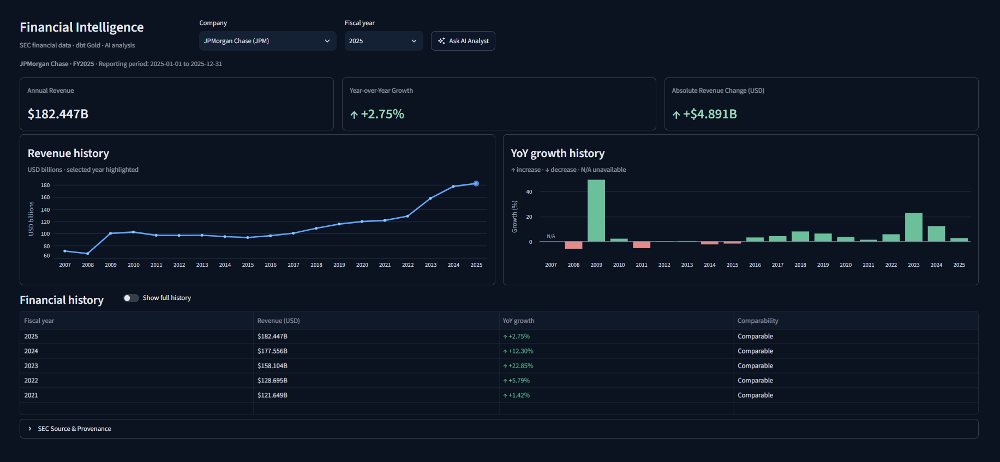
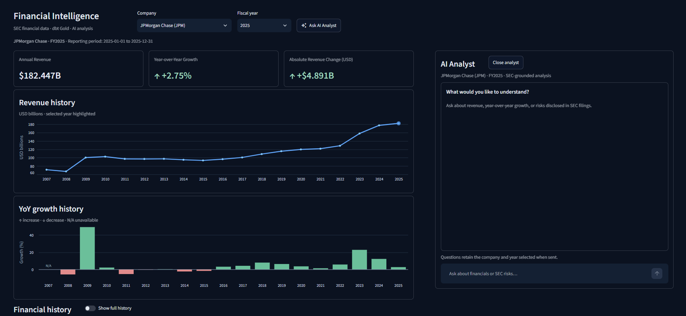
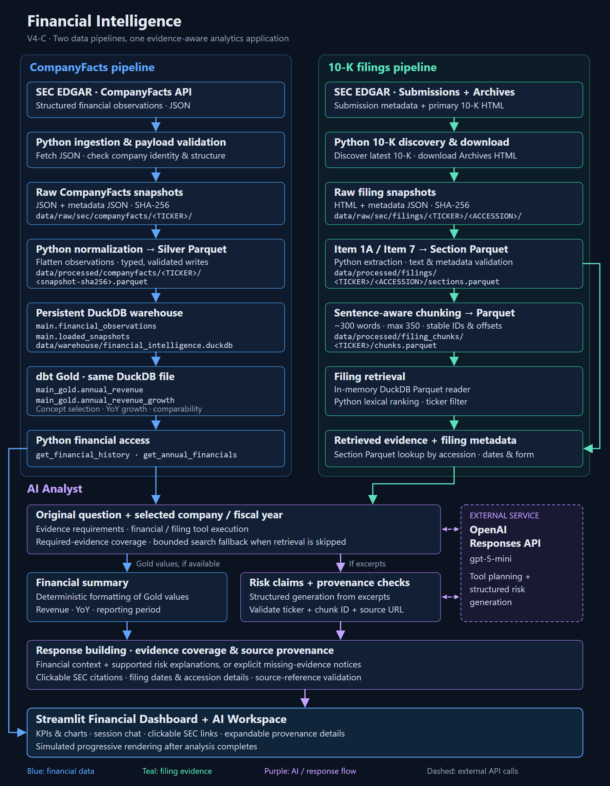

# Financial Intelligence

Financial Intelligence is a local financial analytics platform that transforms SEC filings and structured financial data into traceable insights through Python data pipelines, DuckDB, dbt, and evidence-aware AI analysis. Two independent ingestion pipelines process SEC EDGAR CompanyFacts and 10-K filings, bringing governed financial metrics and cited filing evidence together in an interactive Streamlit application.

The engineering focus is preserving source data, controlling snapshot replacement, producing comparable annual metrics, and making analysis traceable to its inputs.

## Demo



[Open the demo at full size](assets/demo.gif).

## Key capabilities

- **Financial ingestion:** validate CompanyFacts responses, preserve raw snapshots with SHA-256 metadata, and manage the active snapshot for each company.
- **Analytical storage:** normalize filing-level observations into Parquet and a persistent DuckDB warehouse; build annual revenue and YoY growth with dbt.
- **Comparable metrics:** select company-specific revenue concepts, deduplicate annual observations, and flag unsupported year-over-year comparisons.
- **Document processing:** discover the latest available 10-K, extract Item 1A (Risk Factors) and Item 7 (MD&A), and create deterministic chunks with source provenance.
- **SEC retrieval:** search Parquet excerpts with whole-word lexical matching, phrase bonuses, ticker filtering, and deterministic ranking.
- **Evidence-aware analysis:** use Gold metrics for financial figures and retrieved SEC passages for qualitative analysis, with required evidence checks, explicit missing-evidence responses, and clickable filing citations.
- **Interactive workspace:** explore revenue history and growth in Streamlit, then ask questions using the selected company and fiscal year as context.

### Financial dashboard



### Contextual AI Analyst



## Architecture



[Full-resolution architecture](assets/architecture.png) · [Editable SVG](assets/architecture.svg)

**Financial pipeline:** SEC CompanyFacts → raw JSON snapshots → normalized Parquet → persistent DuckDB observations → dbt Gold tables (`main_gold.annual_revenue` and `main_gold.annual_revenue_growth`). The dashboard and financial analysis tools read these Gold tables from `data/warehouse/financial_intelligence.duckdb`.

**Filing pipeline:** SEC submissions and 10-K HTML → raw snapshots → extracted sections → Parquet chunks → lexical retrieval. Retrieval reads the Parquet files through an **in-memory DuckDB connection**, then ranks passages in Python. Filing evidence does not pass through dbt or the persistent financial warehouse.

The paths meet in the application layer. The AI Analyst can request structured financial metrics and filing excerpts through separate tools. The **OpenAI Responses API is an external service** used for AI inference; ingestion, storage, dbt transformations, and lexical retrieval run locally.

| Technology | Role |
|---|---|
| Python, Requests | SEC ingestion, validation, and pipeline orchestration |
| BeautifulSoup, lxml | Filing HTML parsing and section extraction |
| PyArrow, Parquet | Normalized observations, sections, and chunks |
| DuckDB, dbt | Persistent financial warehouse, Gold models, and data tests |
| Streamlit, pandas, Altair | Dashboard, charts, and analyst workspace |
| OpenAI Responses API | Tool-driven analysis and source-linked risk explanations |
| pytest, GitHub Actions | Automated checks and fixture-based CI |

## Engineering decisions

- **Immutable raw snapshots; replaceable active data.** Timestamped raw responses and hashes preserve the inputs for investigation. The financial warehouse holds one active snapshot per company while retaining snapshot-load metadata. Newer snapshots replace that company's observations transactionally; older replacements are rejected. Historical filing-level observations within the active payload remain available.
- **Atomic writes and idempotent reruns.** Processed Parquet is written to temporary files, validated, and atomically replaced. Reloading the same financial snapshot does not duplicate observations; deterministic document processing produces stable chunk identities for unchanged inputs.
- **Company-specific revenue selection.** Gold models rank accounting concepts separately for Microsoft, JPMorgan Chase, and Caterpillar, then select one observation per company and fiscal year-end. Selected concepts and filing identifiers remain available for traceability.
- **Explicit comparability safeguards.** Growth requires consecutive fiscal years and a positive prior-year revenue value. Missing prior years and the identified Microsoft FY2016 reporting-basis mismatch suppress growth. This targeted rule is not a general accounting-restatement detector.
- **Deterministic document provenance.** Chunks retain filing identifiers, source URLs, section hashes, and character offsets. Reconstruction tests check that chunking preserves the normalized section text. Extraction also handles the supported JPMorgan layout where Item 7 references MD&A elsewhere in the filing.
- **Lexical retrieval before a vector database.** Whole-word matching and transparent scoring keep the small local corpus easy to inspect and test without an embedding pipeline or additional storage service. The tradeoff is limited semantic recall.
- **Evidence requirements before presentation.** Financial and filing requests track the evidence they require. The response layer reports missing evidence instead of substituting financial context for unsupported risk analysis. Risk-claim validation checks that ticker, chunk ID, and source URL match retrieved evidence; it does not establish that every explanation is semantically correct.

## Verified local results

The completed local release smoke tests reported the following results. Dataset sizes describe the stored snapshots; test totals and the individual live check are separate validation outcomes.

| Category | Verified result |
|---|---|
| Dataset scope | Microsoft (`MSFT`), JPMorgan Chase (`JPM`), Caterpillar (`CAT`) |
| Financial dataset | 126,163 observations |
| Filing dataset | 396 stored chunks |
| Python test suite | 226 tests passed |
| dbt data tests | 16 tests passed |
| Individual live AI check | Microsoft FY2026 risk analysis returned three cited findings |

These are results from the verified local environment, not guarantees about future SEC responses or model outputs. The single live AI check is not a passing batch evaluation. A fresh installation and fresh SEC download have not been verified as part of this README update.

## Run locally

Use PowerShell from the repository root. Git and Python are required. The verified local release tests used Python 3.12.10, while CI uses Python 3.13. SEC ingestion needs internet access and an identifying User-Agent with your real contact email. AI questions additionally require an OpenAI API key and API access.

### Install

```powershell
git clone https://github.com/Samtoussi/financial-intelligence.git
cd financial-intelligence
python -m venv .venv
.\.venv\Scripts\Activate.ps1
python -m pip install -r requirements.txt
```

### Configure

Set these values in the PowerShell session that will launch the commands:

```powershell
$env:SEC_USER_AGENT = "FinancialIntelligence your-email@example.com"
$env:OPENAI_API_KEY = "your-openai-api-key"
```

Replace the example email with your real contact address and the key placeholder with your own key. **The ingestion runners require `SEC_USER_AGENT` in the process environment; they do not automatically load `.env`.**

The AI Analyst loads the repository-root `.env` and also supports `OPENAI_API_KEY` from the process environment; an existing environment value takes precedence. To use a local file instead, copy the supplied template and edit its placeholders:

```powershell
Copy-Item .env.example .env
```

Keep secrets out of version control. Viewing an already populated dashboard does not require an OpenAI key; submitting AI questions does.

### Populate the local datasets

```powershell
# CompanyFacts for all three companies, Parquet, DuckDB, and dbt Gold build
python run_pipeline.py

# Latest available 10-K, extracted sections, and searchable chunks per company
python -m run_filings MSFT
python -m run_filings JPM
python -m run_filings CAT
```

The filing pipeline runs independently of the financial pipeline. Local data and warehouse files are excluded from version control, so a clone needs population before the dashboard can show financial metrics. These commands match the repository entry points; the completed smoke tests used the existing local setup, rather than a newly installed environment.

### Launch and search

```powershell
python -m streamlit run app.py
```

Optional direct excerpt search after building filing chunks:

```powershell
python -m src.retrieval.search_filings "interest rate risk" --ticker JPM --limit 5
```

### Run tests

```powershell
python -m pytest tests -v
dbt build --project-dir dbt --profiles-dir dbt
```

The dbt command builds the two Gold models and runs their data tests against the populated financial warehouse.

## Tests, CI, and evaluations

**Python tests** cover normalization, historical observations, snapshot lifecycle, financial queries, filing extraction and storage, exact chunk reconstruction, lexical search, evidence collection, response handling, and dashboard presentation. AI behavior is tested with controlled responses rather than requiring live inference for the standard suite.

**dbt tests** check required fields, annual-record uniqueness, valid revenue records, growth calculations, and comparability rules.

**GitHub Actions** installs dependencies, creates a synthetic financial DuckDB fixture with `scripts/create_ci_db.py`, runs `dbt build`, and executes the Python tests. CI does not perform live SEC ingestion.

**Local integration checks** exercise financial and filing evidence paths, missing-evidence behavior, citations, and application presentation. The release smoke tests also included the individual API-backed Microsoft risk-analysis check reported above.

**Separate API-backed evaluations** use cases in `evals/cases.json` to inspect technical evidence requirements and answer coverage:

```powershell
python evals/run.py
```

This command requires local datasets and a configured OpenAI key, makes external API calls, and writes evaluation reports. Historical evaluation output is not presented as a passing current batch. Source-reference and coverage checks do not provide exhaustive semantic fact-checking.

## Scope and limitations

### V4 M002: quarterly report baseline

M002 adds a bounded Microsoft FY2027 Q1 10-Q report experiment to the existing
filing pipeline. It extracts Part I Items 1 and 2, generates six metric pairs,
six YoY changes, and three cited interpretation notes, then evaluates the saved
output against the reviewed M001 fixture. The annual dashboard, analyst, and dbt
Gold models retain their existing contracts.

```powershell
# Reads SEC_USER_AGENT and OPENAI_API_KEY from the root .env (environment wins).
# Downloads only accession 0001193125-26-436133; makes one model call.
python evals/run.py --report-baseline --download

# Re-evaluate a saved run without SEC or OpenAI calls.
python evals/run.py --report-baseline --evaluate-run evals/reports/m002/<run_id>
```

Artifacts are saved under `evals/reports/m002/<run_id>/` and ignored by Git.
Ground truth is never supplied to the generator. Exact Decimal comparisons,
table-row support, citation integrity, and manual semantic review are separate
checks. Exit code **2** means automatic checks passed but human review remains;
pending reviews never count as an overall pass.

The single live baseline produced **12/12 values, 6/6 YoY changes, and 6/6
table-supported pairs** after correcting evaluation parsing of thousands
separators and outer table delimiters. Raw model output and the initial evaluation
are retained. All three qualitative reviews passed human review assisted by
ChatGPT; the saved run has `overall_pass: true` and evaluation exit code **0**.
This is one feasibility run, not a reliability estimate.

See [M002 workflow, artifacts, review rubric, and limitations](evals/M002.md).

### Existing platform limitations

- Three companies are supported: Microsoft, JPMorgan Chase, and Caterpillar. Financial analytics focus on annual revenue and YoY growth.
- Execution is local and on demand; there is no hosted deployment or scheduled ingestion service.
- The filing runner discovers the latest available 10-K. Extraction targets Item 1A and Item 7 and supports the observed layouts; it does not guarantee exhaustive filing coverage.
- Retrieval is lexical and excerpt-based. It has no fiscal-year filter, so selecting a dashboard year does not guarantee that retrieved passages match that fiscal year. Filing metadata helps distinguish reporting periods from filing dates.
- Citation/source-reference validation establishes provenance, not full semantic verification. Retrieved relevance alone does not prove a claim, and disclosed risks do not establish the cause of a revenue change.
- AI inference requires the external OpenAI API and sends the question/context and supporting tool evidence to that service.
- Progressive answer rendering begins after analysis completes; it is a presentation effect rather than live model-token streaming.
- Displayed chat history is retained in the UI but is not passed back as conversational context. Each question uses its own selected company/year context.

This is an engineering portfolio project, not an investment advisory service.

## Repository structure

```text
financial-intelligence/
|-- app.py                       # Streamlit dashboard and contextual analyst
|-- run_pipeline.py              # CompanyFacts -> Parquet -> DuckDB -> dbt
|-- run_filings.py               # 10-K ingestion, extraction, and chunking
|-- src/
|   |-- ingestion/               # SEC requests and raw snapshots
|   |-- transformation/          # Normalization, loading, parsing, and chunking
|   |-- analytics/               # Gold queries and evidence formatting
|   |-- retrieval/               # Lexical search and filing metadata
|   |-- ai/                      # Tool orchestration and evidence-aware responses
|   |-- ui/                      # Analyst answer presentation
|   `-- evaluation/              # Financial evidence validation
|-- dbt/                         # Gold SQL models, data tests, and local profile
|-- tests/                       # Python test suite
|-- evals/                       # API-backed evaluation cases and runner
|-- scripts/create_ci_db.py      # Synthetic financial fixture for CI
|-- .github/workflows/ci.yml      # Automated dbt and Python checks
|-- assets/                      # Demo, screenshots, and architecture diagram
|-- data/                        # Local raw/processed data and warehouse (ignored)
|-- .env.example                 # Configuration template
`-- requirements.txt            # Pinned Python dependencies
```
